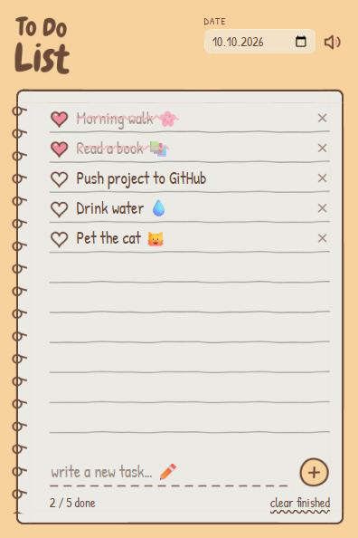

# Cute-ToDo

  

<h1 align="center">Cute ToDo 💖</h1>

  <a href="#-english">🇬🇧 English</a> · <a href="#-türkçe">🇹🇷 Türkçe</a>

  <a href="../../releases/latest"><b>⬇️ Download / İndir</b></a>

  

---

## 🇬🇧 English

A cute, notebook-style to-do list with a hand-drawn look. A lightweight desktop app for Windows.

### ✨ Features

- 📝 Add, edit (double-click) and delete tasks
- 💗 Heart-shaped checkboxes
- 🔊 Cute sound effects for every action (can be muted)
- 📅 Date field
- 🔢 Completed task counter and "clear finished" button
- 💾 Tasks are saved automatically
- 🌐 Works fully offline
- 🎨 All visuals in a hand-drawn style
- 🪶 Very lightweight: the installer is only about 2 MB

### 📦 Installation

1. Download `Cute.Todo_x.x.x_x64-setup.exe` from the [Releases](../../releases/latest) page.
2. Run it and complete the setup.
3. Open **Cute Todo** from the Start menu.

> Don't want to install anything? Download `Cute.Todo.portable.exe` and run it directly.

> If Windows SmartScreen shows an "unrecognized app" warning, click **More info → Run anyway**. This is normal because the app is not digitally signed.

### © License

This app is not open source. The source code is private and all rights are reserved.
You are free to download and use the app for personal use.

---

## 🇹🇷 Türkçe

El çizimi görünümlü, tatlış bir defter tarzı yapılacaklar listesi. Windows için hafif bir masaüstü uygulaması.

### ✨ Özellikler

- 📝 Görev ekleme, düzenleme (çift tıkla) ve silme
- 💗 Kalp şeklinde onay kutuları
- 🔊 Her etkileşime tatlış ses efektleri (kapatılabilir)
- 📅 Tarih alanı
- 🔢 Tamamlanan görev sayacı ve "bitenleri temizle" butonu
- 💾 Görevler otomatik kaydedilir
- 🌐 İnternet bağlantısı gerektirmez
- 🎨 Tüm görseller el çizimi tarzında
- 🪶 Çok hafif: kurulum dosyası yaklaşık 2 MB

### 📦 Kurulum

1. [Releases](../../releases/latest) sayfasından `Cute.Todo_x.x.x_x64-setup.exe` dosyasını indir.
2. Çalıştır ve kurulumu tamamla.
3. Başlat menüsünden **Cute Todo**'yu aç.

> Kurulum yapmak istemiyorsan `Cute.Todo.portable.exe` dosyasını indirip doğrudan çalıştırabilirsin.

> Windows SmartScreen "tanınmayan uygulama" uyarısı verirse **Ek bilgi → Yine de çalıştır** seçeneğine tıkla. Uygulama dijital olarak imzalanmadığı için bu uyarı normaldir.

### © Lisans

Bu uygulama açık kaynak değildir. Kaynak kodu gizlidir ve tüm hakları saklıdır.
Uygulamayı kişisel kullanım için ücretsiz indirip kullanabilirsin.

---

## 🛠️ Built with / Kullanılan teknolojiler

- [Tauri 2](https://tauri.app/) (Rust)
- HTML, CSS, JavaScript

Made with 💖 by <a href="https://github.com/K4YR">K4YR</a> · <a href="https://k4yrdev.com">k4yrdev.com</a>

